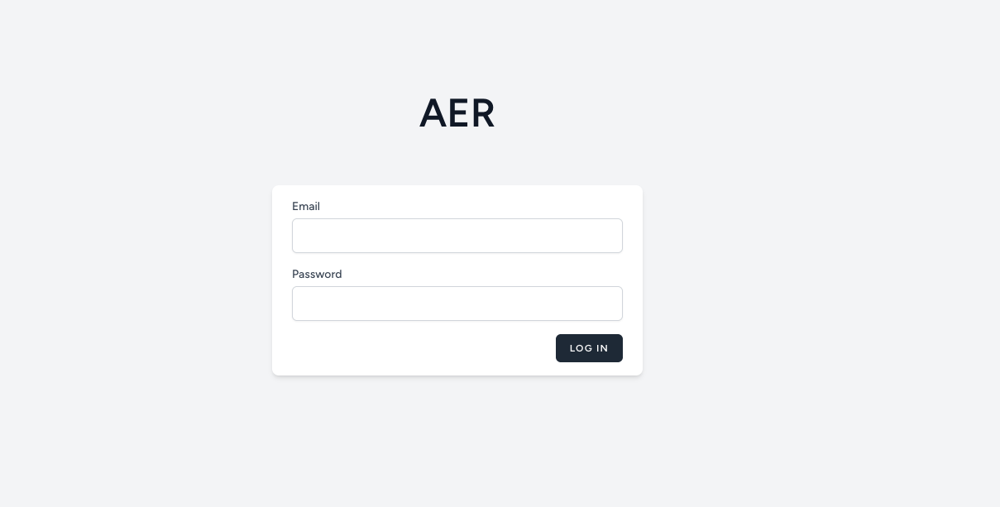
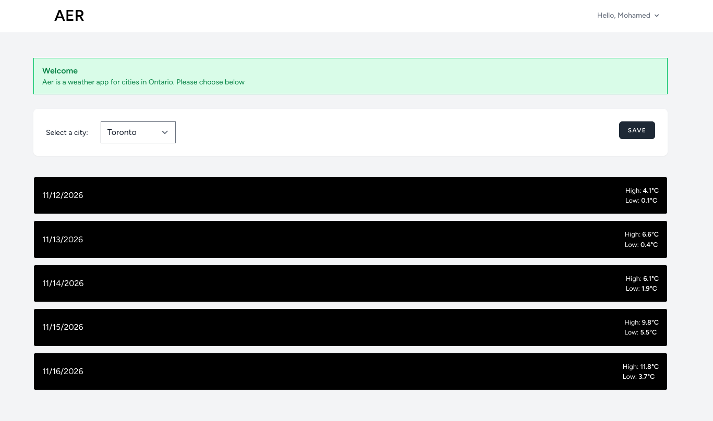
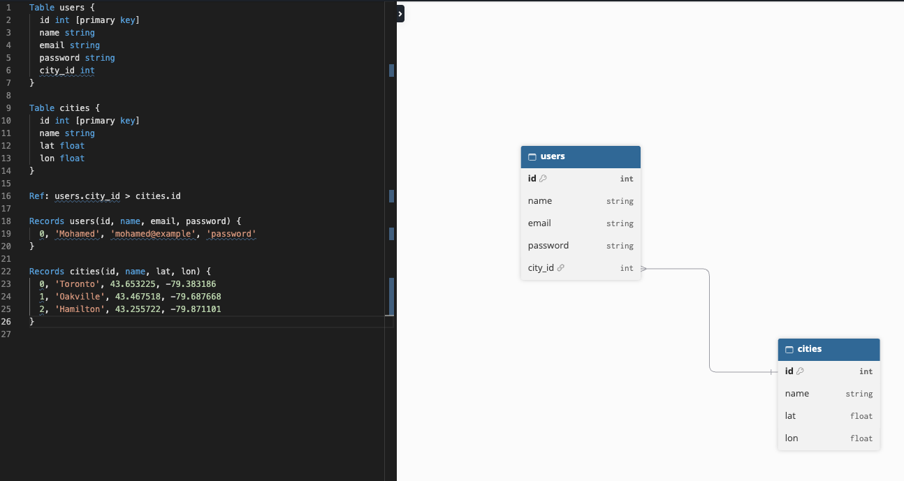

# Aer

City Weather App

## Packages
- Laravel v13.42
- Sail v2.7.0
- Docker Desktop
- Breeze v.24
- Alpine.js
- Tailwind
- Open-Meteo API

---




---


## Installation

1. Install dependencies

   ```
    npm install
    npm run dev
   ```

2. Start the environment

    Open Docker Desktop

   ```
   sail up -d
   ```

3. Seed the database

    ```
    sail artisan db:seed
    ```

---

